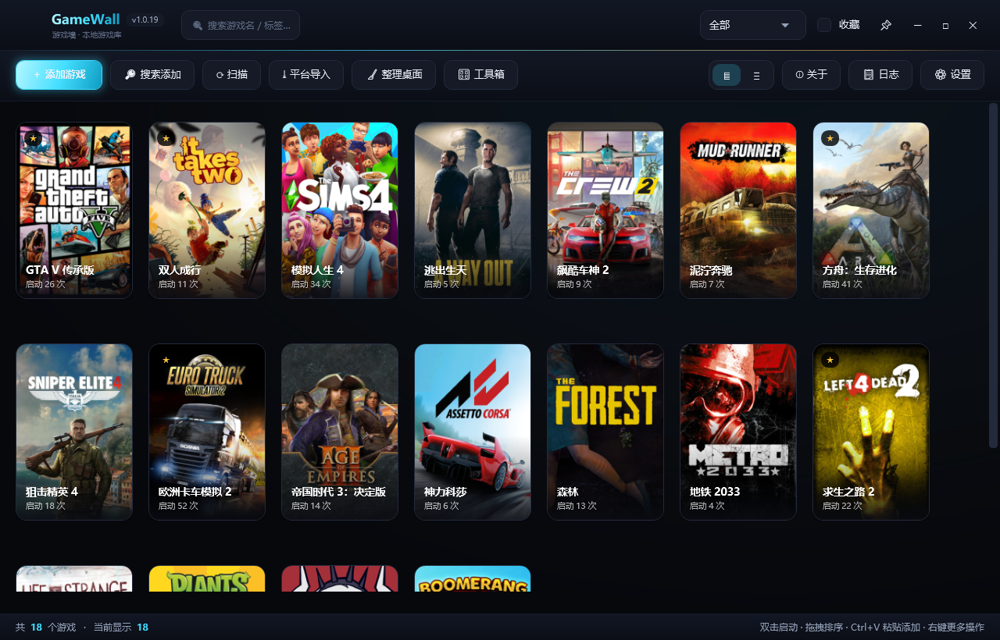
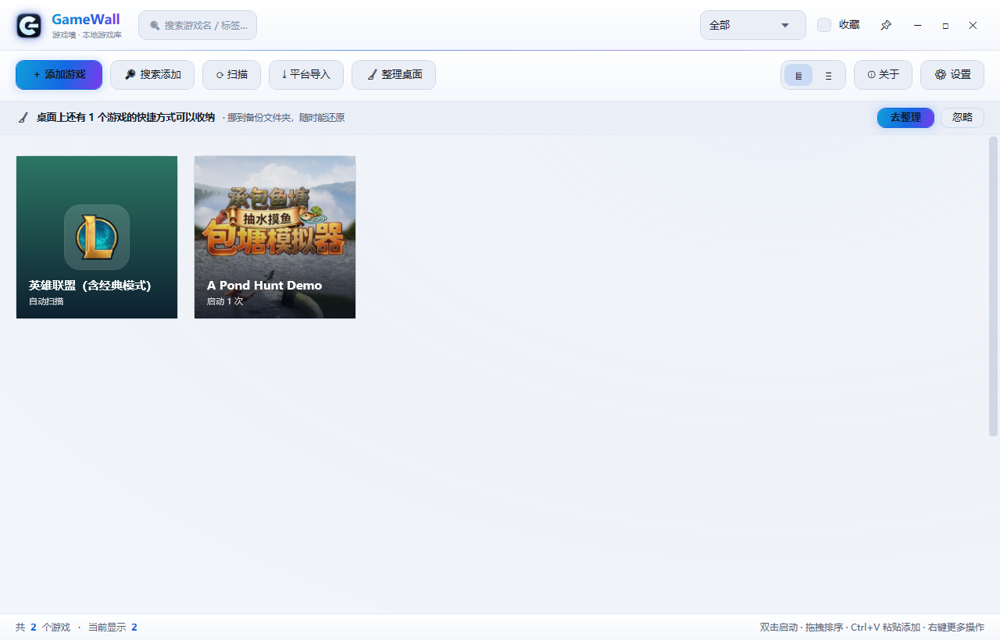
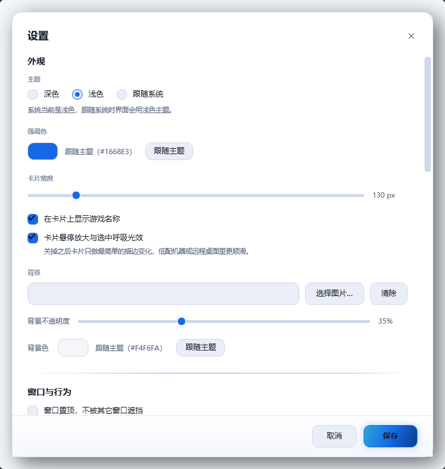
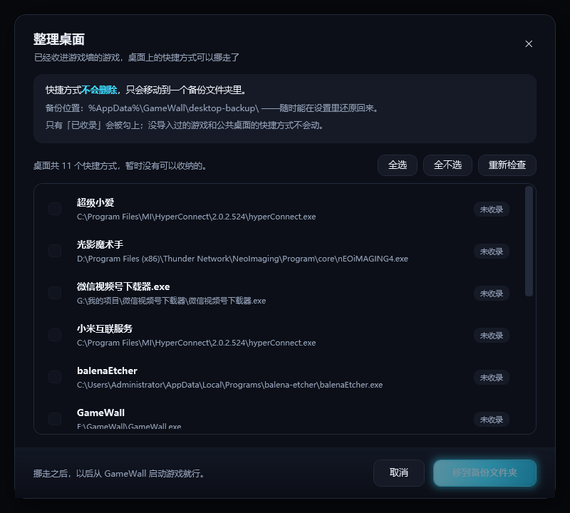
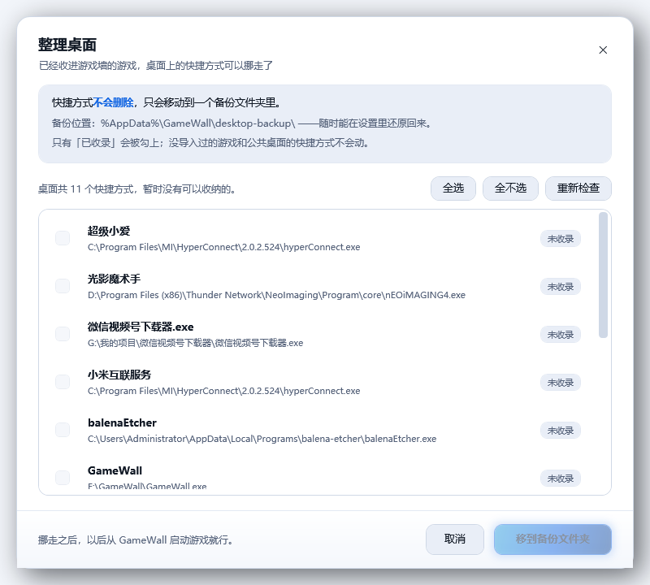
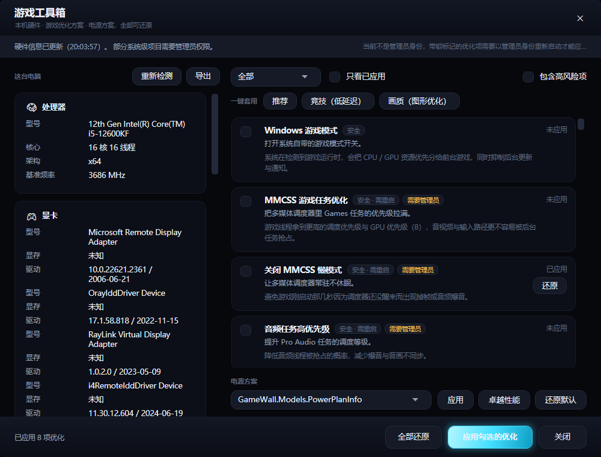
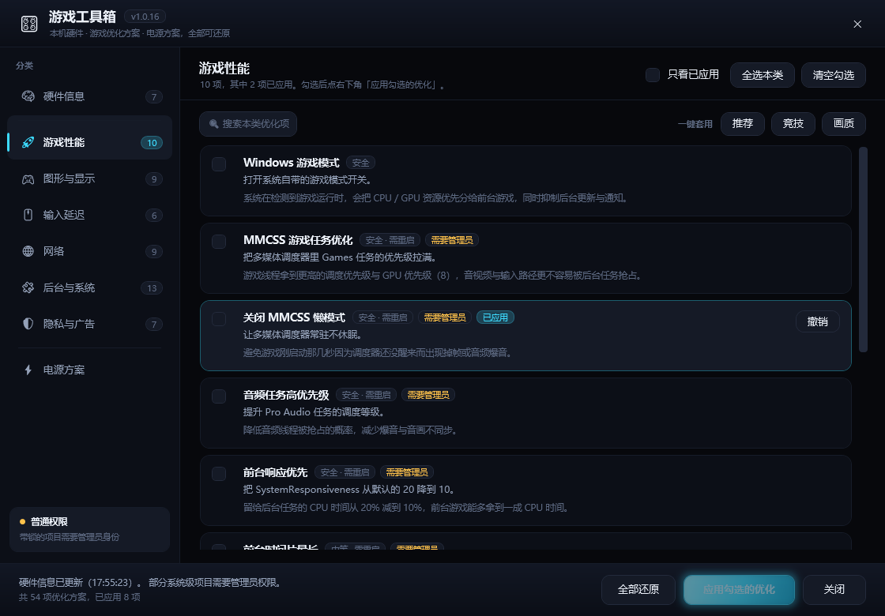
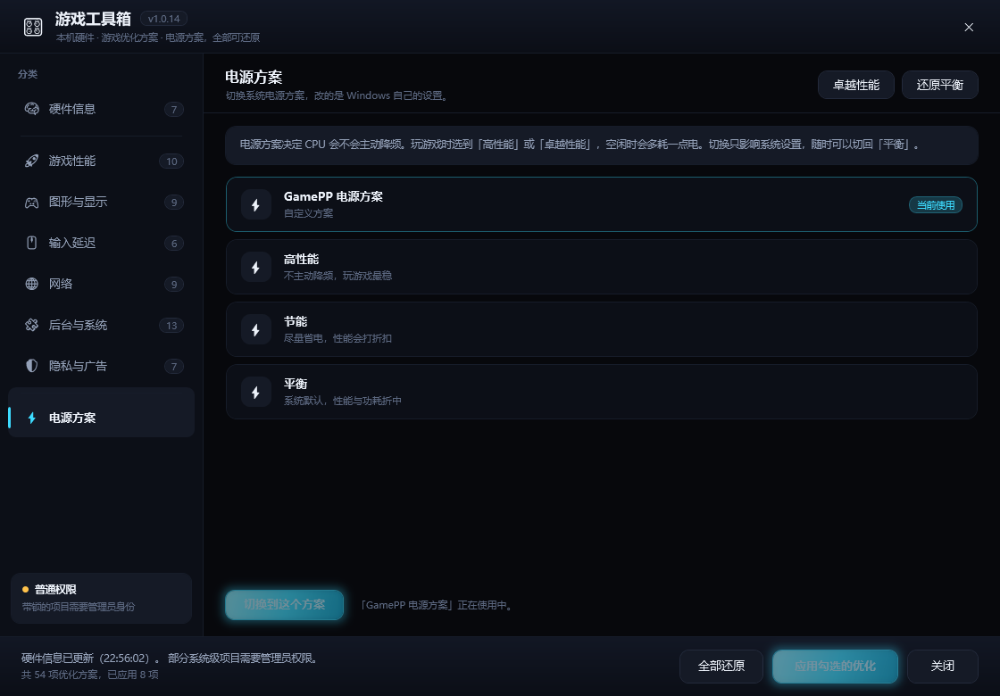
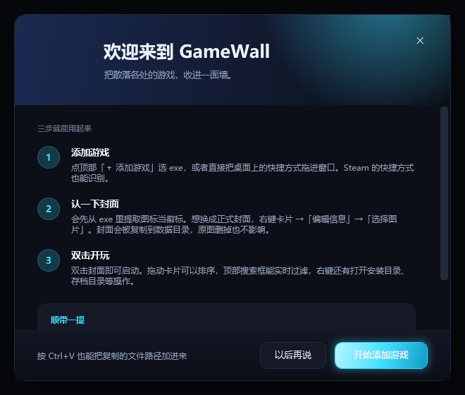

# GameWall

[](https://github.com/jichun29/GameWall-Launcher/releases/latest)
[](https://github.com/jichun29/GameWall-Launcher/releases)
[](https://github.com/jichun29/GameWall-Launcher/stargazers)
[](LICENSE)


Windows 游戏封面墙 · 单文件绿色版，双击即用，不联网



---

## 目录

- [功能特性](#功能特性)
- [界面预览](#界面预览)
- [图标](#图标)
- [系统要求](#系统要求)
- [安装与运行](#安装与运行)
- [使用说明](#使用说明)
- [桌面整理](#桌面整理)
- [游戏工具箱](#游戏工具箱)
- [检查更新](#检查更新)
- [数据存储](#数据存储)
- [从源码编译](#从源码编译)
- [常见问题](#常见问题)
- [关于作者](#关于作者)
- [许可证](#许可证)

---

## 功能特性

### 展示

- **两种视图**：卡片式（默认，像 Steam 游戏库）/ 列表式，顶栏一键切换，选择会被记住
- **卡片密度**：默认卡片宽 150px、封面按 2:3 竖版（150×225），一屏能放下 6~8 张；想更大气可以在设置里拖到 260
- **卡片动效**：悬停时卡片轻微放大（1.032×）并浮起外发光、播放键回弹展开；选中时卡片描边高亮 + 呼吸光晕脉冲
- **竖版封面卡片**：2:3 的长方形封面（不是正方形）+ 游戏名 + 标签胶囊 + 启动次数，悬停高亮描边
- **封面与图标分开处理**：自己指定了封面就满铺；没封面但有 exe 图标时居中当徽标摆（32×32 的小图标不会被拉伸成黑块）；两者都没有才用按名字哈希生成的渐变底 + 首字
- **Steam 游戏自动取官方封面**：从 Steam 自己的 `appcache\librarycache` 里找 600×900 竖版封面，纯本地读取，不联网
- **双击启动**：卡片双击直接拉起游戏，也可右键菜单启动
- **拖拽排序**：按住卡片拖到目标位置即可重排，顺序自动保存
- **无效路径标记**：exe 被删掉后卡片会显示「文件缺失」角标，一键筛选清理
- **自适应布局**：窗口拉窄时工具栏自动换行，不会把按钮挤出窗口
- **虚拟化渲染**：只实例化视口里的那几行卡片，200 个游戏和 6 个游戏的首屏一样快（实测 200 条启动约 1 秒，内存约 170 MB）
- **暗黑霓虹视觉**：深空黑渐进底色、电光青强调色、卡片悬停外发光、渐变标题与霓虹分隔线；
  控件统一 38px 高、18px 内边距、10~14px 圆角，不再贴边

### 添加游戏

| 方式 | 说明 |
| --- | --- |
| 手动添加 | 选 `.exe` / `.lnk` / `.url`，自动提取 256×256 图标 |
| 拖拽添加 | 从资源管理器把 `.exe` / `.lnk` / `.url` 拖进窗口（Steam 游戏快捷方式会自动识别成 `steam://` 启动） |
| 粘贴添加 | `Ctrl+V` 直接粘贴剪贴板里的文件或路径文本 |
| 搜索添加 | 输入游戏名，在指定目录里递归搜索匹配的 exe |
| 自动扫描 | 扫描常见游戏目录，自动剔除平台本体 / 启动器 / 运行库，同一游戏只留主程序 |
| 平台导入 | 读取 Steam / Epic / GOG 已安装列表（走各平台官方启动 URI） |

### 管理与筛选

- **右键菜单**：启动 / 打开安装目录 / 打开存档目录 / 编辑信息 / 收藏 / 移除
- **编辑信息**：自定义名称、可执行文件、存档目录、标签、备注、封面
- **封面**：选本地图片 / 用 exe 图标 / 清除（清除后回退到居中图标徽标或自动渐变占位封面）
- **标签系统**：逗号或空格分隔多标签，顶栏下拉按标签筛选
- **实时搜索**：空格分词，多关键词 AND 匹配名称 / 标签 / 备注 / 来源
- **收藏**：`★` 标记，可只看收藏

### 桌面整理

- **一键收纳**：已经收进游戏墙的游戏，桌面上的快捷方式可以一次性挪走，之后只从 GameWall 进游戏
- **只挪不删**：全部移动到 `%AppData%\GameWall\desktop-backup\<时间戳>\`，目录里写 `restore.json` 记录原始路径，设置里一键还原
- **只动已收录的**：没导入过的快捷方式和公共桌面（`C:\Users\Public\Desktop`）的项一律不碰
- **扫描后询问**：扫描 / 平台导入 / 拖放新增之后会问一句「要现在把它们挪走吗？」，顶栏也会提示「桌面还能再干净一点」

### 游戏工具箱

左侧一整条分类栏，右侧整块只显示当前分类的内容：

| 分类 | 内容 |
| --- | --- |
| 🧠 硬件信息 | CPU / 主板与 BIOS / 内存 / 显卡 / 硬盘分区 / 显示器 / 网卡，外加「针对这台机器的建议」 |
| 🚀 游戏性能 | 游戏模式、MMCSS 任务优先级、CPU 调度量子等 |
| 🎮 图形与显示 | 硬件加速 GPU 调度、独显优先、Flip Model、Auto HDR / VRR、着色器缓存 |
| 🖱 输入延迟 | 鼠标加速、键盘重复、菜单与悬停延迟 |
| 🌐 网络 | 网络限流、CTCP、TTL、TCP 超时与端口、DNS 缓存、QoS |
| 🧩 后台与系统 | 游戏 DVR / Game Bar / Xbox 服务、SysMain、搜索索引、NTFS 与音频 |
| 🛡 隐私与广告 | 推荐内容、活动历史、Copilot、Recall、NVIDIA 遥测 |
| ⚡ 电源方案 | 当前方案与全部方案列表，一键切换 / 复制卓越性能 |

- **本机硬件一览**：全部走 Win32 / 注册表读取，不装驱动、不联网
- **43 项 Windows 深度调整**：每项都标了风险等级和实际效果；分类角标直接显示该类项数
- **搜索与批量操作**：优化页可按名字 / 效果搜索（`Ctrl+F`），支持「全选本类」「清空勾选」，另有「推荐 / 竞技（低延迟）/ 画质」三套一键预设
- **快捷键**：`Ctrl+1` 硬件、`Ctrl+2` 优化、`Ctrl+3` 电源，`Esc` 清搜索再关窗
- **改之前先记旧值**：每一项写注册表之前都会把原值存进 `%AppData%\GameWall\tweaks\applied.json`，还原时不存在的值直接删掉，不会糊一个 0 上去
- **电源方案**：直接调 `powrprof.dll` 枚举 / 切换 / 复制电源方案，可一键切「高性能」「卓越性能」（没有就复制一份出来），不调 `powercfg.exe`
- **硬件报告导出**：一键导出 TXT / JSON 到桌面
- **权限一目了然**：左栏底部那张小卡会告诉你当前是管理员还是普通权限，改动后即时显示「已应用 N 项」

### 体验

- **三种主题模式**：深色 / 浅色 / **跟随系统**（默认深色）。
  选「跟随系统」后，在 Windows 里切换「应用模式」的深浅色，GameWall 会立刻跟着换肤，无需重启。
- 强调色可自定义（或一键「跟随主题」，深色用电光青 #3DDBFF、浅色用 #1668E3）
- 自定义背景图（支持透明度调节）或纯色背景（也可「跟随主题」）
- 窗口置顶、全屏模式、无边框自绘标题栏（可拖动、可双击最大化）
- 顶栏高度 64px、工具栏独立一行，窄窗口下按钮不再互相挤压
- 最小化到系统托盘，托盘菜单可直接添加 / 扫描 / 整理桌面 / 设置 / 检查更新 / 退出
- 开机自启（写入 `HKCU\...\CurrentVersion\Run`）
- 启动游戏后可自动最小化（`--silent` 参数支持启动即进托盘）
- 首次运行有引导页；单实例锁，重复启动会唤醒已有窗口

---

## 界面预览

> 下面这套图都是程序真实渲染的结果（`RenderTargetBitmap` 直接抓窗口视觉树，不是拼的示意图）。

### 卡片式视图（默认）

深色：


浅色：



### 列表式视图


### 设置面板

深色：


浅色（含「跟随系统」主题、强调色「跟随主题」、更新源选择）：



### 整理桌面

深色：



浅色：



### 游戏工具箱（左栏分类，右侧整块内容）

硬件信息页：



优化方案页（左栏切到「游戏性能」）：



电源方案页：



### 首次运行引导



> 截图由 `tools/make-screenshots.ps1` / `tools/shoot-theme.ps1` 在线抓取，
> 也可用离线宿主 `snap-host` 直接 `RenderTargetBitmap` 渲染（远程桌面 / 无桌面合成环境下更可靠）。

---

## 图标


应用图标是**一个大写字母 G**（Game 的 G），用几何方式现画而不是排字体：

- 超椭圆底盘（n=4.6），深空蓝 → 近黑竖向渐变，左上一团冷光
- 青 → 琥珀的霓虹描边，模拟发光管（刻意避开青转紫，那种渐变是最典型的「AI 生成感」配色）
- 字母本体是白色 → 浅青的竖向渐变，带一层投影和上沿高光
- 右侧开口 + 中间横杠构成 G 的字骨，横杠左端做 45° 斜切，小尺寸下也认得出

ICO 内含 10 个尺寸（16 / 20 / 24 / 32 / 40 / 48 / 64 / 96 / 128 / 256），24px 以下自动切换到
加粗笔画、收窄开口、去掉外发光的简化版，任务栏和标题栏里都不糊。

重新生成（需要 Pillow）：

```bash
python tools/make-logo.py

```

产物写入 `src/GameWall/Assets/`：`GameWall.ico`（exe / 托盘图标）、`logo-256.png`（顶栏品牌标识）、
`logo-1024.png`（高清母版）。

---

## 系统要求

- Windows 10 1809+ / Windows 11（x64）
- 安装版 / 免安装版：无额外依赖（自包含单文件）
- 框架依赖版：需 .NET 8 Desktop Runtime

## 安装与运行

### 方式一：安装版（推荐）

1. 到 [Releases](https://github.com/jichun29/GameWall-Launcher/releases) 下载 `GameWall-Setup-x.y.z.exe`
2. 双击安装。**默认装到非系统盘**——程序会枚举所有本地磁盘，跳过 C 盘，在剩下的盘里挑剩余空间最大的那个（例如 `E:\Program Files\GameWall`；该盘没有 `Program Files` 就直接放 `E:\GameWall`）。只有整台机器就一个 C 盘时才装到 C 盘。
3. 安装过程会问你要不要在桌面放快捷方式，装完可以直接启动
4. 卸载走「设置 → 应用」或开始菜单里的「卸载 GameWall」。**卸载只删程序本身，`%AppData%\GameWall` 里的游戏库、封面和优化备份都会保留**

### 方式二：免安装版

1. 下载 `GameWall.exe`
2. 放到任意目录（例如 `D:\Tools\GameWall\`），双击运行
3. 首次启动会显示引导页，点「开始使用」即可

> 单文件自包含版约 66 MB，首次启动会解压到临时目录（约 2 秒），之后启动稳定在 1 秒以内。

### 方式三：从源码编译

见 [从源码编译](#从源码编译)。

---

## 使用说明

### 添加第一个游戏

四种入口任选：

1. 点工具栏 **＋ 添加游戏**，可多选 `.exe` / `.lnk` / `.url`；
2. 直接把桌面快捷方式拖进窗口（`.lnk` 指向 `steam.exe -applaunch <id>`、`.url` 内容是 `steam://rungameid/<id>` 时，会自动变成「Steam 游戏」并显示商店里的正式游戏名）；
3. 复制文件后按 `Ctrl+V`，或直接粘贴一行 exe 路径；
4. 点 **🔎 搜索添加**，输入名字（如 `elden`），从搜索结果里双击或勾选添加。

添加后会自动提取 exe 图标，Steam 游戏还会顺手从本地缓存里取官方竖版封面。想要换成自己的图：右键卡片 → **编辑信息** → **选择图片…**。

### 自动扫描

点工具栏 **⟳ 扫描**，会遍历设置里的「扫描目录」（默认自动探测各盘符下的 `Games` / `SteamLibrary` / `游戏`，
以及 Steam 注册表里登记的所有库目录的 `steamapps\common`、`Program Files\Epic Games`、`GOG Galaxy\Games` 等），

- **先剔除「不是游戏的东西」**：卸载器、安装器、运行库（vcredist / UE4Prereq）、反作弊（EAC / BattlEye / Vanguard）、
  崩溃上报、录制器、平台本体（`steam.exe`、`EpicGamesLauncher.exe`、`UbisoftExtension.exe`、`WeGame.exe` …）
- **同一游戏只留主程序**：一个《英雄联盟》目录里有 90 多个 exe（大厅、启动器、录制器、反作弊、教练 AI），
  按「路径里有没有 client/launcher/cross 这类目录 → 埋得深不深 → 体积」三档打分，只留 `Game\League of Legends.exe`
- **名字取游戏自己的目录名，不取自建文件夹名**：你把游戏放在 `D:\Games\XIAORIZI\JAPANSTIGMATIZED\` 这种自己起的分类夹里时，
  显示的是 `JAPANSTIGMATIZED` 而不是 `XIAORIZI`——自建文件夹是分类，不是游戏名，用它去找封面永远对不上
- **自动配封面**：扫描完成时按四条线索找图，找到就存进 `%AppData%\GameWall\covers\`（全本地，不联网）：
  1. 游戏目录里自带的 `cover.png` / `folder.jpg` / `poster.*` 之类（按文件名和像素尺寸挑，太小的图标会被排除）
  2. 目录里的 `steam_appid.txt` → 直接用该 appid 去本地 Steam 缓存取官方竖版封面
  3. 按游戏名和本机 Steam 库里的游戏做模糊匹配（中英对照、简称全称都能认，比如「英雄联盟微game版」↔「英雄联盟」）
  4. 都没有就退到渐变底 + 游戏名首字母标牌（多单词取前两词首字母，如 `Sniper Elite 4` → **SE**）
- 跳过已添加的游戏，只导入新的

目录、递归深度、最小 exe 体积都可以在 **⚙ 设置 → 扫描目录** 里调整。

> 扫描只认「像游戏的 exe」。如果你手动把记事本、Photoshop 拖进来，GameWall 不会拦——
> 手动添加永远以你的选择为准，自动扫描才做过滤。

### 平台导入

点工具栏 **⤓ 平台导入**，自动读取本机已安装的 Steam / Epic / GOG 游戏列表，勾选后导入。

导入的项目走各平台自己的启动协议：

| 平台 | 启动方式 |
| --- | --- |
| Steam | `steam://rungameid/{appid}` |
| Epic | `com.epicgames.launcher://apps/{AppName}?action=launch&silent=true` |
| GOG | `galaxy2://runGame/{gameId}` |

这样能正确触发平台的 DRM 校验和云存档。

### 快捷键与操作

| 操作 | 效果 |
| --- | --- |
| 双击卡片 | 启动游戏 |
| 右键卡片 | 打开上下文菜单 |
| 拖拽卡片 | 调整顺序 |
| 双击标题栏 | 最大化 / 还原 |
| 拖拽标题栏 | 移动窗口 |
| 拖动窗口四边 | 调整大小（6px 热区） |
| `Ctrl+F` | 聚焦搜索框 |
| `Ctrl+V` | 粘贴剪贴板里的文件 / 路径并导入 |
| `↑` `Enter`（搜索框） | 直接启动筛选结果里的第一个 |
| `Esc`（搜索框聚焦时） | 清空搜索 |
| `Esc` | 清空全部筛选条件 |
| `F5` | 刷新封面与图标 |
| `Delete` | 移除选中的游戏（会二次确认） |

### 设置项

**外观**：主题（深色 / 浅色 / 跟随系统）、强调色（可跟随主题）、卡片宽度（110–260，默认 150；封面高度按 2:3 自动算）、是否显示文字标签、卡片动效开关（关掉后悬停放大与选中呼吸光都停用，只保留描边高亮）、背景图、背景色（可跟随主题）、背景遮罩透明度

**窗口与行为**：置顶、启动即全屏、最小化到托盘、开机自启、移除前确认、启动游戏后最小化自己

**扫描目录**：增删扫描根目录、递归深度（1–8）、最小 exe 体积

**更新**：启动时自动检查（每天最多一次）、更新源（自动 / GitHub 直连 / GHProxy / ghfast.top / gh-proxy.com / moeyy / gitmirror）、立即检查

**桌面整理**：扫描/导入后是否询问整理桌面、顶栏是否提示「桌面还能再干净一点」、立即整理、还原到桌面、打开备份目录

**数据与关于**：打开数据目录、关于 GameWall（作者信息与检查更新）、恢复全部默认设置

---

## 桌面整理

游戏都收进 GameWall 之后，桌面上的快捷方式就没有存在意义了。工具栏点「🧹 整理桌面」，或者等它自己问：

1. 扫描 / 平台导入 / 拖放新增之后，会弹一句「桌面还有 N 个快捷方式可以挪走，要现在处理吗？」
2. 顶栏也会出现一条提示「桌面上还有 N 个快捷方式可以挪走」，点「去整理」即可（不想要可以在设置里关掉）
3. 窗口里列出桌面上所有 `.lnk` / `.url`，**只有已经在 GameWall 里的会被勾上**，没导入过的一律不动
4. 确认后全部移动到 `%AppData%\GameWall\desktop-backup\<yyyyMMdd-HHmmss>\`，同目录写 `restore.json` 记录原始路径

> **不会删除任何文件。** 想找回来：设置 → 桌面整理 → 「还原到桌面」（还原最近一批，已存在同名文件时跳过不覆盖），或直接点「打开备份目录」自己搬。

公共桌面 `C:\Users\Public\Desktop` 里的快捷方式会列出来但不允许勾选（那是所有用户共享的，动它需要管理员权限）。

### 怎么认定「这条快捷方式就是库里那个游戏」

按四条判据从强到弱比，前三条命中就够，第四条是给「同一款游戏装了两份」准备的：

| 判据 | 说明 |
| --- | --- |
| 启动协议相同 | 同一个 `steam://rungameid/<appid>` 一定是同一款 |
| exe 路径相同 | 最直接 |
| 同一个安装目录 | 快捷方式有时指向游戏目录里的启动器而不是主程序 |
| **快捷方式的名字对得上** | 专门对付平台版差异：桌面上那条叫「英雄联盟微game版」，库里收录的是「英雄联盟（含经典模式）」，两份文件、两个目录、毫无路径关系，只能靠名字认。<br>比对用的是**快捷方式自己的显示名**（玩家能看到的那串字），不是它指向的 exe 文件名——拿 `Client` 去跟「英雄联盟」比永远比不出结果。<br>中英对照、简称全称、版本后缀都能认，但 Sequel 会分开：`Sniper Elite 4` 和 `3` 不会互相认领 |

---

## 游戏工具箱

工具栏的「🎛 工具箱」是本机硬件体检 + Windows 游戏优化方案，参考了 [NexBox](https://github.com/MuLiuSaMa/NexBox) 的思路自己重写（NexBox 是 GPL-3.0，这里没有复制它的代码，只借鉴了「哪些项真的影响游戏」这份清单）。

### 布局

窗口是「左栏分类 + 右侧整块内容」的两段式：

- 左栏列 8 个分类（硬件信息、六个优化分类、电源方案），选中项左侧亮起一根强调色竖条、图标与标题一起变色、右侧角标显示该类项数
- 右侧永远只显示**一个**分类的内容：点「硬件信息」整块就是硬件信息，点「网络」整块就是网络那 9 项，不会像之前那样左右两栏挤在一起
- 底部固定一条操作栏：左边是状态文字（当前权限、已应用几项），右边是按当前分类变化的按钮（硬件页是「重新检测 / 导出报告」，优化页是「全部还原 / 应用勾选的优化」，电源页是「切换到这个方案」）

快捷键：`Ctrl+1` 硬件、`Ctrl+2` 优化、`Ctrl+3` 电源、`Ctrl+F` 定位搜索框、`Esc` 先清搜索（清空后再按才关窗）。

### 硬件一览

按处理器 / 内存 / 显卡 / 硬盘 / 显示器 / 主板与系统 / 网络分节，全部走 `Win32`（`GetSystemInfo`、`GlobalMemoryStatusEx`、`EnumDisplayDevices` 等轻量接口）与注册表读取，**不装驱动、不联外网**。点「重新检测」可以重扫，点「导出报告」可以存成 TXT / JSON 到桌面。

读不到信息的字段会**整行隐藏**，不会在界面上留「未知」占位：远程会话 / 虚拟显示适配器（向日葵、ToDesk、Parsec 等）直接过滤，OEM 没填的机型占位符（`System Product Name`）当成空，构建号 ≥ 22000 的系统名纠正为 Windows 11。

底部还会给出几条针对性建议（比如「内存占用偏高，可以关掉常驻的后台程序」「系统盘剩余空间不足 10%」「检测到独显，但没有在系统里首选独显」），每条都直接带一个可以点的优化项。

### 优化方案

按六类分组，共 43 项，每项标了风险等级与实际效果：

| 分类 | 例子 |
| --- | --- |
| 🚀 游戏性能 | 游戏模式、MMCSS 游戏任务优先级、SystemResponsiveness、Win32PrioritySeparation、电源节流 |
| 🎮 图形与显示 | 硬件加速 GPU 计划（HAGS）、首选独显、Flip Model、Auto HDR、可变刷新率、着色器缓存 |
| 🖱 输入延迟 | 鼠标加速、键盘重复延迟、菜单展开延迟、悬停延时 |
| 🌐 网络 | 网络节流、CTCP 拥塞控制、TTL、ECN、TCP 已用端口、DNS 缓存、QoS 保留带宽 |
| 🧩 后台与系统 | 游戏 DVR、Xbox 服务、SysMain、NTFS 上次访问时间、音频独占与空间音效 |
| 🛡 隐私与广告 | 开始菜单推荐、活动历史、Copilot、Recall 快照、Click to Do |

三套预设（推荐 / 竞技 / 画质）点一下就把对应项勾上；「全选本类」「清空勾选」用来快速批处理；顶部搜索框可以按名字 / 效果过滤。带 🔒 的项需要**以管理员身份运行**才能应用（程序会提示，不会静默失败）。

> **每一项都先记旧值，随时能还原。** 原值存在 `%AppData%\GameWall\tweaks\applied.json`：值本来存在就写回去，本来不存在就删掉这个值（不会补一个 0）。「全部还原」一次撤回所有已应用的项。改动都要重启或重登才完全生效。

### 电源方案

直接调 `powrprof.dll`（`PowerEnumerate` / `PowerSetActiveScheme` / `PowerDuplicateScheme`），不依赖 `powercfg.exe`：

- **高性能** —— 系统自带的方案，一键切换
- **卓越性能** —— 系统里没有就复制一份出来（部分版本被微软隐藏了）
- **还原默认** —— 切回「平衡」

---

## 检查更新

「关于 GameWall」窗口和设置面板里都能手动检查更新；开启「启动时自动检查」后，程序每天最多自动查一次（记在 `settings.json` 的 `LastCheckAt`）。

- **版本比较**只认 GitHub Releases 上的 `tag_name`（形如 `v1.0.10`），比本地 `AssemblyInformationalVersion` 高才提示
- **下载**走同一套源列表，逐个试到成功为止；下完先校验字节数和 `sha256`（GitHub 会回 `digest`），一致才落地
- **安装**：把新版下到临时目录 → 拷到程序同目录 → 生成一个等待旧进程退出的 `.cmd` → 覆盖并重启。只对**单文件版**生效（绿色版结构变了没法热替换，会提示你手动替换）
- **加速源**：国内直连 `api.github.com` 有时会断，所以内置了 `ghfast.top`、`ghproxy.net`、`gh-proxy.com`、`github.moeyy.xyz`、`hub.gitmirror.com` 五个镜像，「自动」模式会从直连开始挨个试

> 版本号规则由 `tools/release.ps1` 守着：**主版本 1、次版本 0 固定，每次发版只递增第三位**（1.0.9 → 1.0.10 → 1.0.11）。这样不会出现「一天跳好几个大版本」。发版记录存在 `tools/release-history.json`。

---

## 数据存储

全部在 `%AppData%\GameWall\`（即 `C:\Users\<你>\AppData\Roaming\GameWall\`）：

```
GameWall/
├─ library.json          # 游戏列表（名称/路径/封面/标签/启动统计…）
├─ settings.json         # 全部设置
├─ gamewall.log          # 运行日志（出问题时看这个）
├─ covers/               # 自定义封面图副本 + 自动生成的占位封面
├─ icons/                # 从 exe 提取的图标缓存（256×256 PNG）
├─ backgrounds/          # 自定义背景图副本
├─ desktop-backup/       # 「整理桌面」挪走的快捷方式（每批一个时间戳目录 + restore.json）
└─ tweaks/               # 「游戏工具箱」改过的注册表项的原始值（applied.json，用于还原）

```

`library.json` 单条记录长这样：

```json
{
  "Id": "635d5353af974dba83fb20b1dd693132",
  "Name": "Elden Ring",
  "LaunchKind": "Executable",
  "ExecutablePath": "D:\\Games\\ELDEN RING\\Game\\eldenring.exe",
  "WorkingDirectory": "D:\\Games\\ELDEN RING\\Game",
  "CoverPath": null,
  "SaveDirectory": "C:\\Users\\me\\AppData\\Roaming\\EldenRing",
  "Tags": ["RPG", "开放世界"],
  "Notes": null,
  "IsFavorite": true,
  "AddedAt": "2026-09-23T12:03:30.4927543+08:00",
  "LastLaunchAt": "2026-10-21T12:03:30.4927543+08:00",
  "LaunchCount": 12,
  "SortIndex": 1,
  "Source": "手动添加"
}

```

写入采用「临时文件 → 备份旧文件 → 原子替换」，断电或崩溃不会写坏存档；JSON 解析失败时会保留 `.corrupt-时间戳` 备份并回到默认值。

**备份 / 迁移**：整个 `GameWall` 文件夹复制走即可。**重置**：删除该文件夹，或在设置里点「恢复默认设置」。

### settings.json 里的主题字段

```json
{
  "Theme": "Dark",
  "AccentColor": "",
  "BackgroundColor": ""
}

```

- `Theme` 取 `"Dark"` / `"Light"` / `"System"`，非法值一律按 `"Dark"` 处理
- `AccentColor` / `BackgroundColor` 留空字符串表示「跟随主题」，填 `#RRGGBB` 则固定使用

---

## 从源码编译

### 前置

- [.NET 8 SDK](https://dotnet.microsoft.com/download/dotnet/8.0)（仅编译需要，运行不需要）
- Visual Studio 2022 / Rider / VS Code 任选，或纯命令行

### 命令行

```powershell
git clone https://github.com/jichun29/GameWall-Launcher.git
cd GameWall-Launcher

# 调试运行
dotnet run --project src/GameWall/GameWall.csproj

# 发布单文件（自包含，约 66 MB，目标机无需装运行时）
dotnet publish src/GameWall/GameWall.csproj -c Release -r win-x64 --self-contained true -o dist

# 发布单文件（框架依赖，约 380 KB，目标机需装 .NET 8 Desktop Runtime）
dotnet publish src/GameWall/GameWall.csproj -c Release -r win-x64 --self-contained false -o dist

```

> 用后者时记得到 `src/GameWall/GameWall.csproj` 把 `<SelfContained>` 改成 `false`，
> 并去掉 `EnableCompressionInSingleFile`（单文件压缩只在自包含发布时可用）。

产物在 `dist/GameWall.exe`，单文件、免安装、无第三方依赖。自包含版 66 MB（含 .NET 运行时），框架依赖版仅 380 KB。

### 打安装包

安装包用 [Inno Setup 6](https://jrsoftware.org/isinfo.php) 生成，脚本在 `installer/GameWall.iss`：

```powershell
# 先产出 dist\GameWall.exe，再编译安装包
ISCC.exe installer\GameWall.iss
```

产物是 `dist\GameWall-Setup-<版本>.exe`，版本号自动从 `GameWall.exe` 的文件版本读取。

安装包的默认目录由脚本里的 `PickInstallDir()` 现算：枚举所有本地固定磁盘 → 跳过系统盘 → 在剩下的盘里挑剩余空间最大的 → 该盘有 `Program Files` 就装进去，没有就直接放盘符根下。只有整台机器只有一个 C 盘时才装到 C 盘。桌面快捷方式由用户在安装向导里勾选，卸载时不会碰 `%AppData%\GameWall`。

### 用 Visual Studio

打开 `GameWall.sln`，把 `GameWall` 设为启动项目，F5 即可。

---

## 常见问题

**Q：双击后提示「找不到可执行文件」？**
游戏被移动或删除了。右键卡片 → 编辑信息 → 重新指定 exe；或用顶栏的「筛选」查看无效项后清理。

**Q：选了「跟随系统」但没换色？**
GameWall 读的是 `HKCU\...\Themes\Personalize\AppsUseLightTheme`（「应用」模式），不是「Windows 模式」。
如果两个值不一致，以「应用」模式为准。切换后若界面未变，检查 `%AppData%\GameWall\gamewall.log` 里最近的
`主题已应用：System → Light/Dark` 记录。

**Q：平台导入读不到游戏？**
只读取本机已安装的列表。Steam 需至少启动过一次客户端（`libraryfolders.vdf` 才会写全），Epic 需要 `%ProgramData%\Epic\UnrealEngineLauncher\LauncherInstalled.dat` 存在。

**Q：扫描扫出来的是 Steam / WeGame 客户端本身，不是游戏？**
早期版本会把整个 Steam 安装目录当游戏目录扫，这个问题已经修掉：现在会自动跳过平台客户端的安装目录，
只认 `steamapps\common`、`Epic Games\<游戏名>`、`GOG Galaxy\Games` 这些真正的游戏落点；
即使是真的游戏目录，也会再排除启动器、大厅客户端、运行库、反作弊、录制器等子目录。

**Q：桌面上的 Steam 游戏快捷方式拖进去提示「无法识别」？**
已支持 `.url` / `.lnk` 里的平台协议。`steam://rungameid/5194080`、`steam.exe -applaunch 5194080`、
`com.epicgames.launcher://apps/...`、`galaxy2://runGame/...` 都会被识别成对应平台的游戏，
游戏名和安装目录从本地清单里反查，显示的是商店里的正式名字。

**Q：扫描扫不到我的游戏？**
到 **⚙ 设置 → 扫描目录** 手动加上游戏所在根目录，并把「递归深度」调大（默认 4 层），「最小 exe 体积」调小。

**Q：关窗口后程序还在？**
默认「最小化到托盘」。想直接退出：托盘图标右键 → 退出，或在设置里关掉「最小化到托盘」。

**Q：数据能换电脑带走吗？**
能。复制整个 `%AppData%\GameWall\` 文件夹，但游戏路径是绝对路径，换机器后需要重新指向。

**Q：游戏多了会不会变卡？**
不会。卡片列表是虚拟化的，只生成当前视口覆盖到的那些行，滚到哪儿生成到哪儿，滚出去的会被回收。
实测 200 个游戏和 6 个游戏的首屏耗时一样（约 1 秒），内存都在 170 MB 上下。

**Q：整理桌面会不会把我的快捷方式删了？**
不会。全部是**移动**到 `%AppData%\GameWall\desktop-backup\<时间戳>\`，同一个目录里写了 `restore.json`
记录每个文件的原始路径。想找回来：设置 → 桌面整理 → 「还原到桌面」，或直接「打开备份目录」自己搬回去。

**Q：整理桌面为什么有些快捷方式没被勾上？**
只勾「已经在 GameWall 里」的那些。没导入过的游戏、软件快捷方式，以及公共桌面
（`C:\Users\Public\Desktop`，所有用户共享）的项一律不动——勾选也不会被允许。

**Q：游戏工具箱里的优化项安全吗？会不会改坏系统？**
每一项写注册表之前都会把原值存进 `%AppData%\GameWall\tweaks\applied.json`，点「全部还原」能一条条撤回；
原值本来不存在的会把该值删掉，而不是补一个 0。风险等级为「高」的项（比如直接改显卡驱动子键的几项）
默认不勾，必须手动打开「包含高风险项」才会出现。仍然建议勾之前看一眼每项下面那行「效果」说明。

**Q：优化项点了没反应？**
带 🔒 的项要**以管理员身份运行**才能写 `HKLM`。窗口顶部会显示当前是不是管理员身份；
不是的话关掉程序，右键 exe → 以管理员身份运行后再试。另外大部分项要重启或重新登录才完全生效。

**Q：工具箱里的硬件信息和任务管理器对不上？**
工具箱读的是 `Win32_Processor` 之外的轻量接口 + 注册表，频率显示的是**基准频率**（不是实时睿频），
内存/显卡占用是采样的瞬时值；远程桌面会话下显卡型号可能显示成 `Microsoft Remote Display Adapter`，这是正常的。

**Q：出问题了怎么排查？**
看 `%AppData%\GameWall\gamewall.log`。没有日志的话，多半是 XAML 资源或启动期异常，用 `dotnet run` 跑调试版能看到堆栈。

---

## 关于作者

| | |
| --- | --- |
| 作者 | 季春二九 |
| GitHub | [@jichun29](https://github.com/jichun29) |
| 项目主页 | [jichun29/GameWall-Launcher](https://github.com/jichun29/GameWall-Launcher) |
| 问题反馈 | [Issues](https://github.com/jichun29/GameWall-Launcher/issues) |

程序内的「关于 GameWall」窗口同样展示了作者信息、版本号、许可证与检查更新入口。

---

## 许可证

MIT License，详见 [LICENSE](LICENSE)。

Copyright (c) 2026 季春二九 (jichun29)
