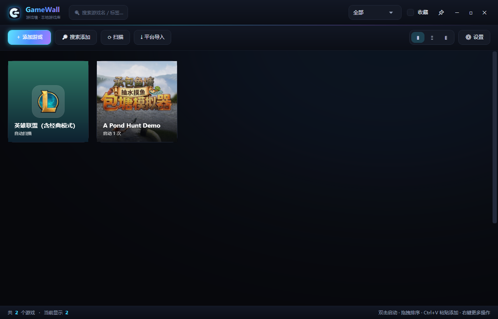
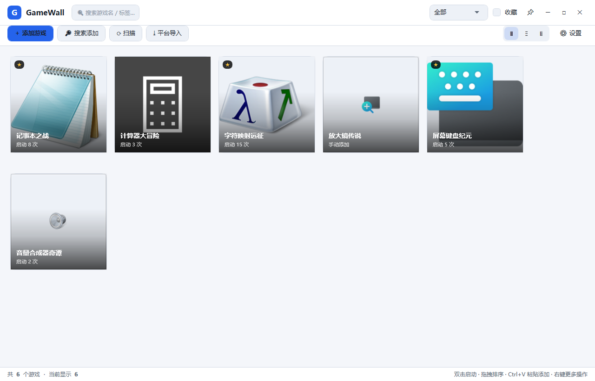
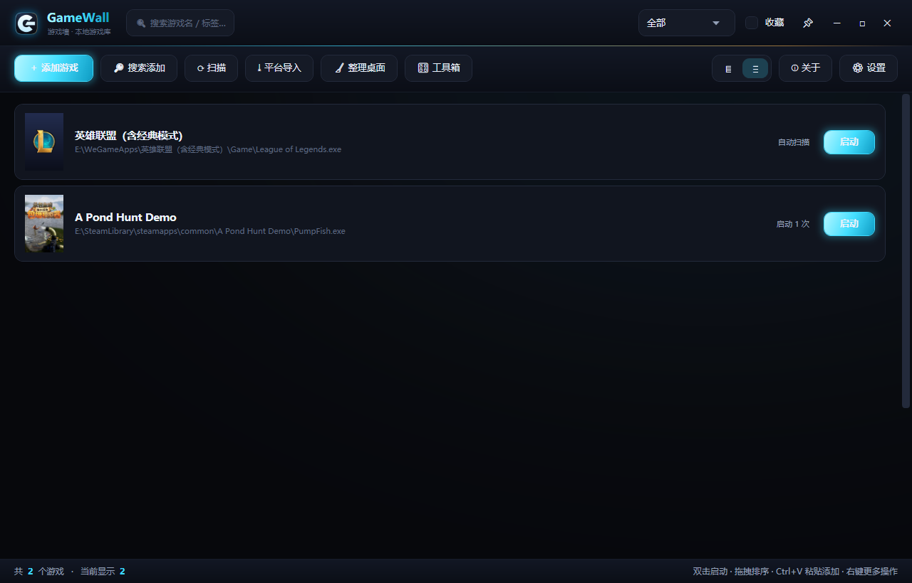
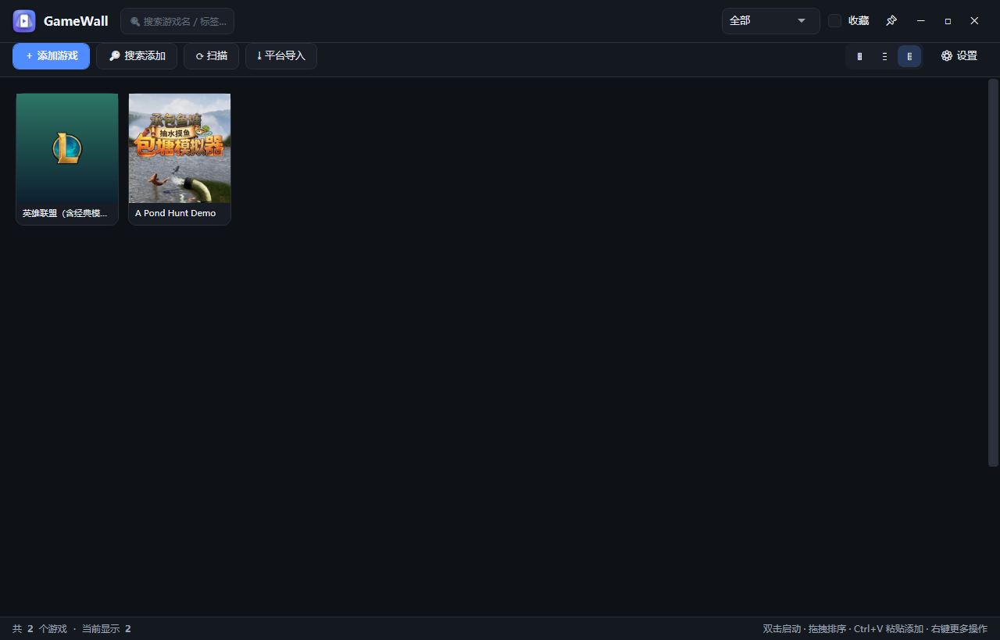
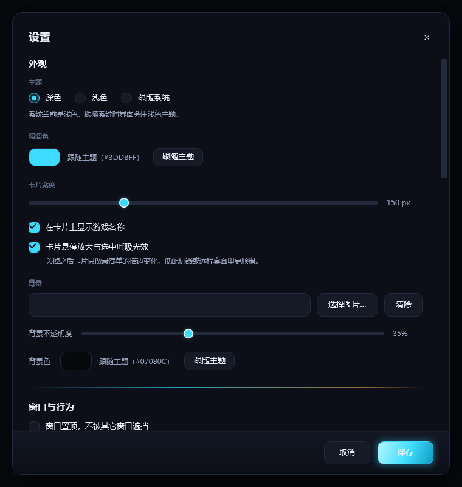

# GameWall

> A lightweight Windows game launcher with visual wall-style game management.

把散落在桌面上的单机游戏快捷方式收进一面「封面墙」——像 Steam 大图模式，但更轻、更专注，只干一件事：**点开就玩**。

纯本地工具，不联网、不上传任何数据，所有配置都存在 `%AppData%\GameWall\` 下。



---

## 目录

- [功能特性](#功能特性)
- [界面预览](#界面预览)
- [系统要求](#系统要求)
- [安装与运行](#安装与运行)
- [使用说明](#使用说明)
- [数据存储](#数据存储)
- [从源码编译](#从源码编译)
- [项目结构](#项目结构)
- [开发路线](#开发路线)
- [常见问题](#常见问题)
- [许可证](#许可证)

---

## 功能特性

### 展示

- **三种视图**：大图墙（默认）/ 列表 / 紧凑，顶栏一键切换，选择会被记住
- **封面卡片**：封面图 + 游戏名 + 标签胶囊 + 启动次数，悬停高亮描边
- **双击启动**：卡片双击直接拉起游戏，也可右键菜单启动
- **拖拽排序**：按住卡片拖到目标位置即可重排，顺序自动保存
- **无效路径标记**：exe 被删掉后卡片会显示「找不到文件」角标，一键筛选清理
- **自适应布局**：窗口拉窄时工具栏自动换行，不会把按钮挤出窗口

### 添加游戏

| 方式 | 说明 |
| --- | --- |
| 手动添加 | 选 `.exe`，自动提取 256×256 图标作为封面 |
| 拖拽添加 | 从资源管理器把 `.exe` / `.lnk` / `.url` 拖进窗口 |
| 粘贴添加 | `Ctrl+V` 直接粘贴剪贴板里的文件或路径文本 |
| 搜索添加 | 输入游戏名，在指定目录里递归搜索匹配的 exe |
| 自动扫描 | 扫描常见游戏目录，按体积和目录名打分排序，批量导入 |
| 平台导入 | 读取 Steam / Epic / GOG 已安装列表（走各平台官方启动 URI） |

### 管理与筛选

- **右键菜单**：启动 / 打开安装目录 / 打开存档目录 / 编辑信息 / 收藏 / 移除
- **编辑信息**：自定义名称、可执行文件、存档目录、标签、备注、封面
- **封面**：选本地图片 / 用 exe 图标 / 清除（清除后回退到自动渐变占位封面）
- **标签系统**：逗号或空格分隔多标签，顶栏下拉按标签筛选
- **实时搜索**：空格分词，多关键词 AND 匹配名称 / 标签 / 备注 / 来源
- **收藏**：`★` 标记，可只看收藏

### 体验

- **三种主题模式**：深色 / 浅色 / **跟随系统**（默认深色）。
  选「跟随系统」后，在 Windows 里切换「应用模式」的深浅色，GameWall 会立刻跟着换肤，无需重启。
- 强调色可自定义（或一键「跟随主题」，深色用 #4F8CFF、浅色用 #2563EB）
- 自定义背景图（支持透明度调节）或纯色背景（也可「跟随主题」）
- 窗口置顶、全屏模式、无边框自绘标题栏（可拖动、可双击最大化）
- 最小化到系统托盘，托盘菜单可直接添加 / 扫描 / 退出
- 开机自启（写入 `HKCU\...\CurrentVersion\Run`）
- 启动游戏后可自动最小化（`--silent` 参数支持启动即进托盘）
- 首次运行有引导页；单实例锁，重复启动会唤醒已有窗口

---

## 界面预览

### 深色（默认）


### 浅色



### 列表模式



### 紧凑模式



### 设置面板（含「跟随系统」主题）



> 截图由 `tools/shoot-theme.ps1` / `tools/make-screenshots.ps1` 在程序运行时自动抓取
> （`PrintWindow` + `PW_RENDERFULLCONTENT`，对 WPF 无边框窗口也能拿到真实渲染内容）。

---

## 系统要求

- Windows 10 1809+ / Windows 11（x64）
- 免安装版：无额外依赖（自包含单文件）
- 框架依赖版：需 .NET 8 Desktop Runtime

## 安装与运行

### 方式一：下载即用（推荐）

1. 到 [Releases](../../releases) 下载 `GameWall.exe`
2. 放到任意目录（例如 `D:\Tools\GameWall\`），双击运行
3. 首次启动会显示引导页，点「开始使用」即可

> 单文件自包含版约 66 MB，首次启动会解压到临时目录（约 1 秒），之后启动更快。

### 方式二：从源码编译

见 [从源码编译](#从源码编译)。

---

## 使用说明

### 添加第一个游戏

四种入口任选：

1. 点工具栏 **＋ 添加游戏**，多选 `.exe`；
2. 直接把桌面快捷方式 `.lnk` 拖进窗口；
3. 复制文件后按 `Ctrl+V`，或直接粘贴一行 exe 路径；
4. 点 **🔎 搜索添加**，输入名字（如 `elden`），从搜索结果里双击或勾选添加。

添加后会自动提取 exe 图标做封面。想要更漂亮的大图封面：右键卡片 → **编辑信息** → **选择图片…**。

### 自动扫描

点工具栏 **⟳ 扫描**，会遍历设置里的「扫描目录」（默认自动探测各盘符下的 `Games`、`SteamLibrary\steamapps\common`、`Program Files\Epic Games` 等），

- 过滤卸载器 / 运行库 / 反作弊等噪声 exe
- 按「文件体积 + 目录名与 exe 名一致」打分排序
- 跳过已添加的游戏，只导入新的

目录、递归深度、最小 exe 体积都可以在 **⚙ 设置 → 扫描目录** 里调整。

### 平台导入

点工具栏 **⤓ 平台导入**，自动读取本机已安装的 Steam / Epic / GOG 游戏列表，勾选后导入。

导入的项目走各平台自己的启动协议：

| 平台 | 启动方式 |
| --- | --- |
| Steam | `steam://rungameid/{appid}` |
| Epic | `com.epicgames.launcher://apps/{AppName}?action=launch&silent=true` |
| GOG | `galaxy2://runGame/{gameId}` |

这样能正确触发平台的 DRM 校验和云存档。

### 快捷键与操作

| 操作 | 效果 |
| --- | --- |
| 双击卡片 | 启动游戏 |
| 右键卡片 | 打开上下文菜单 |
| 拖拽卡片 | 调整顺序 |
| 双击标题栏 | 最大化 / 还原 |
| 拖拽标题栏 | 移动窗口 |
| 拖动窗口四边 | 调整大小（6px 热区） |
| `Ctrl+F` | 聚焦搜索框 |
| `Ctrl+V` | 粘贴剪贴板里的文件 / 路径并导入 |
| `↑` `Enter`（搜索框） | 直接启动筛选结果里的第一个 |
| `Esc`（搜索框聚焦时） | 清空搜索 |
| `Esc` | 清空全部筛选条件 |
| `F5` | 刷新封面与图标 |
| `Delete` | 移除选中的游戏（会二次确认） |

### 设置项

**外观**：主题（深色 / 浅色 / 跟随系统）、强调色（可跟随主题）、卡片宽度、是否显示文字标签、背景图、背景色（可跟随主题）、背景遮罩透明度

**窗口与行为**：置顶、启动即全屏、最小化到托盘、开机自启、移除前确认、启动游戏后最小化自己

**扫描目录**：增删扫描根目录、递归深度（1–8）、最小 exe 体积

**数据与关于**：打开数据目录、恢复全部默认设置

---

## 数据存储

全部在 `%AppData%\GameWall\`（即 `C:\Users\<你>\AppData\Roaming\GameWall\`）：

```
GameWall/
├─ library.json          # 游戏列表（名称/路径/封面/标签/启动统计…）
├─ settings.json         # 全部设置
├─ gamewall.log          # 运行日志（出问题时看这个）
├─ covers/               # 自定义封面图副本 + 自动生成的占位封面
├─ icons/                # 从 exe 提取的图标缓存（256×256 PNG）
└─ backgrounds/          # 自定义背景图副本
```

`library.json` 单条记录长这样：

```json
{
  "Id": "635d5353af974dba83fb20b1dd693132",
  "Name": "Elden Ring",
  "LaunchKind": "Executable",
  "ExecutablePath": "D:\\Games\\ELDEN RING\\Game\\eldenring.exe",
  "WorkingDirectory": "D:\\Games\\ELDEN RING\\Game",
  "CoverPath": null,
  "SaveDirectory": "C:\\Users\\me\\AppData\\Roaming\\EldenRing",
  "Tags": ["RPG", "开放世界"],
  "Notes": null,
  "IsFavorite": true,
  "AddedAt": "2026-09-23T12:03:30.4927543+08:00",
  "LastLaunchAt": "2026-10-21T12:03:30.4927543+08:00",
  "LaunchCount": 12,
  "SortIndex": 1,
  "Source": "手动添加"
}
```

写入采用「临时文件 → 备份旧文件 → 原子替换」，断电或崩溃不会写坏存档；JSON 解析失败时会保留 `.corrupt-时间戳` 备份并回到默认值。

**备份 / 迁移**：整个 `GameWall` 文件夹复制走即可。**重置**：删除该文件夹，或在设置里点「恢复默认设置」。

### settings.json 里的主题字段

```json
{
  "Theme": "Dark",
  "AccentColor": "",
  "BackgroundColor": ""
}
```

- `Theme` 取 `"Dark"` / `"Light"` / `"System"`，非法值一律按 `"Dark"` 处理
- `AccentColor` / `BackgroundColor` 留空字符串表示「跟随主题」，填 `#RRGGBB` 则固定使用

---

## 从源码编译

### 前置

- [.NET 8 SDK](https://dotnet.microsoft.com/download/dotnet/8.0)（仅编译需要，运行不需要）
- Visual Studio 2022 / Rider / VS Code 任选，或纯命令行

### 命令行

```powershell
git clone https://github.com/jichun29/GameWall-Launcher.git
cd GameWall-Launcher

# 调试运行
dotnet run --project src/GameWall/GameWall.csproj

# 发布单文件（自包含，约 66 MB，目标机无需装运行时）
dotnet publish src/GameWall/GameWall.csproj -c Release -r win-x64 --self-contained true -o dist

# 发布单文件（框架依赖，约 380 KB，目标机需装 .NET 8 Desktop Runtime）
dotnet publish src/GameWall/GameWall.csproj -c Release -r win-x64 --self-contained false -o dist
```

> 用后者时记得到 `src/GameWall/GameWall.csproj` 把 `<SelfContained>` 改成 `false`，
> 并去掉 `EnableCompressionInSingleFile`（单文件压缩只在自包含发布时可用）。

产物在 `dist/GameWall.exe`，单文件、免安装、无第三方依赖。自包含版 66 MB（含 .NET 运行时），框架依赖版仅 380 KB。

### 用 Visual Studio

打开 `GameWall.sln`，把 `GameWall` 设为启动项目，F5 即可。

---

## 项目结构

```
GameWall/
├─ GameWall.sln
├─ src/GameWall/
│  ├─ GameWall.csproj          # net8.0-windows / WPF / 单文件发布配置
│  ├─ app.manifest            # PerMonitorV2 高 DPI + Win10/11 兼容标记
│  ├─ App.xaml / App.xaml.cs  # 启动、单实例锁、托盘图标、全局异常兜底
│  ├─ Models/
│  │  ├─ GameEntry.cs         # 一条游戏记录
│  │  └─ AppSettings.cs       # 全部设置项 + 主题模式常量
│  ├─ Services/
│  │  ├─ JsonStore.cs         # 路径解析 + 原子化 JSON 读写
│  │  ├─ LibraryService.cs    # 游戏列表的增删改排序
│  │  ├─ SettingsService.cs   # 设置读写 + 非法值修正 + 旧版本迁移
│  │  ├─ IconService.cs       # 用 IShellItemImageFactory 提取高清图标
│  │  ├─ CoverFactory.cs      # 没有封面时按名字哈希生成渐变占位图
│  │  ├─ LaunchService.cs     # 按类型启动 exe / steam:// / epic / gog
│  │  ├─ GameScanner.cs       # 递归扫描 + 噪声过滤 + 打分排序
│  │  ├─ PlatformImportService.cs  # 读 Steam/Epic/GOG 已装列表
│  │  ├─ ShortcutResolver.cs  # .lnk / .url 解析成真实 exe
│  │  ├─ AutoStartService.cs  # 开机自启注册表操作
│  │  ├─ SystemThemeWatcher.cs# 读注册表 + 监听系统深浅色切换
│  │  ├─ ThemeManager.cs      # 主题与强调色热切换
│  │  └─ Logger.cs            # 简易滚动日志
│  ├─ ViewModels/
│  │  ├─ ObservableObject.cs  # INotifyPropertyChanged 基类
│  │  ├─ RelayCommand.cs      # 同步 / 异步命令
│  │  ├─ GameCardViewModel.cs # 单张卡片的展示状态
│  │  └─ MainViewModel.cs     # 主界面状态、筛选、命令
│  ├─ Views/
│  │  ├─ MainWindow.xaml(.cs)        # 主窗口：三视图 + 拖拽 + 拖放/粘贴导入
│  │  ├─ FirstRunWindow.xaml(.cs)    # 首次运行引导
│  │  └─ Dialogs/
│  │     ├─ GameEditWindow.xaml(.cs) # 编辑游戏信息
│  │     ├─ SearchAddWindow.xaml(.cs)# 搜索添加
│  │     ├─ ImportWindow.xaml(.cs)   # 平台导入
│  │     └─ SettingsWindow.xaml(.cs) # 设置
│  ├─ Themes/
│  │  ├─ Dark.xaml / Light.xaml      # 两套色板（同名键一一对应）
│  │  └─ Controls.xaml               # 全部自绘控件样式
│  ├─ Assets/GameWall.ico            # 应用图标（exe 图标 + 托盘图标共用）
│  └─ Converters/Converters.cs       # 路径→图片、布尔→可见性等
├─ tools/
│  ├─ capture.ps1             # 抓单个窗口截图的小工具
│  ├─ make-screenshots.ps1    # 自动切换视图并批量截图
│  ├─ shoot-theme.ps1         # 切换主题后重新出图（深/浅两套）
│  ├─ shot-dialogs.ps1        # 抓设置对话框
│  ├─ audit-layout.ps1        # UIA 排版审计（越界 / 重叠检测）
│  ├─ seed-demo.ps1           # 造演示数据
│  └─ make-icon.ps1           # 现场生成多尺寸 .ico（无需外部素材）
└─ docs/screenshots/          # README 用图
```

**技术选型**：C# + WPF（.NET 8）。零第三方 NuGet 依赖——图标提取直接 P/Invoke `IShellItemImageFactory`，注册表读写走 `Microsoft.Win32`，占位封面用 `DrawingVisual` 渲染，系统主题监听走 `Microsoft.Win32.SystemEvents`。启动约 1 秒，界面无外部 UI 框架开销。

---

## 开发路线

- [x] **P0 核心**：游戏墙展示 + 手动（含拖拽 / 粘贴）添加 + 双击启动 + 右键菜单
- [x] **P1 重要**：实时搜索 + 标签分类筛选 + 封面自定义 + 拖拽排序 + 收藏
- [x] **P2 增强**：自动扫描 + 平台导入（Steam/Epic/GOG）+ 启动统计 + 存档目录
- [x] **P3 体验**：深/浅/跟随系统三态主题 + 强调色 + 背景图 + 全屏 + 置顶 + 开机自启 + 系统托盘
- [ ] 后续可做：多语言、游戏时长统计（需要注入/进程监控）、手柄导航、
      云同步（用户自己的同步盘）、截图预览墙、按最近游玩自动排序

---

## 常见问题

**Q：双击后提示「找不到可执行文件」？**
游戏被移动或删除了。右键卡片 → 编辑信息 → 重新指定 exe；或用顶栏的「筛选」查看无效项后清理。

**Q：选了「跟随系统」但没换色？**
GameWall 读的是 `HKCU\...\Themes\Personalize\AppsUseLightTheme`（「应用」模式），不是「Windows 模式」。
如果两个值不一致，以「应用」模式为准。切换后若界面未变，检查 `%AppData%\GameWall\gamewall.log` 里最近的
`主题已应用：System → Light/Dark` 记录。

**Q：平台导入读不到游戏？**
只读取本机已安装的列表。Steam 需至少启动过一次客户端（`libraryfolders.vdf` 才会写全），Epic 需要 `%ProgramData%\Epic\UnrealEngineLauncher\LauncherInstalled.dat` 存在。

**Q：扫描扫不到我的游戏？**
到 **⚙ 设置 → 扫描目录** 手动加上游戏所在根目录，并把「递归深度」调大（默认 4 层），「最小 exe 体积」调小。

**Q：关窗口后程序还在？**
默认「最小化到托盘」。想直接退出：托盘图标右键 → 退出，或在设置里关掉「最小化到托盘」。

**Q：数据能换电脑带走吗？**
能。复制整个 `%AppData%\GameWall\` 文件夹，但游戏路径是绝对路径，换机器后需要重新指向。

**Q：出问题了怎么排查？**
看 `%AppData%\GameWall\gamewall.log`。没有日志的话，多半是 XAML 资源或启动期异常，用 `dotnet run` 跑调试版能看到堆栈。

---

## 许可证

MIT License，详见 [LICENSE](LICENSE)。
